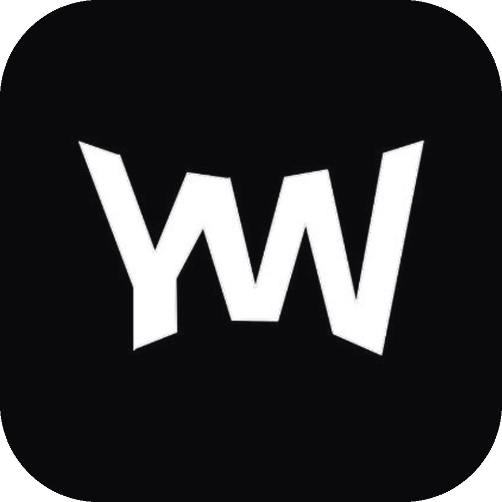

<p align="center"></p>

<h1 align="center">YW Studio</h1>

<p align="center">Бесплатная open-source DAW от коллектива #YW · <a href="https://yolo.su">yolo.su</a></p>

---

**YW Studio** — лёгкая рабочая станция для битмейкеров под Windows с привычным пэттерн-воркфлоу: Channel Rack, Piano Roll, Playlist, Mixer и Browser на своих местах, те же хоткеи и меню. Оформление, иконки и код — свои.

> Статус: ранняя разработка (v0.1). Работает каркас: главное окно, все меню, тулбар с транспортом и темпом, браузер, менеджер плагинов (VST3), настройки аудио. Редакторы — следующий этап.

## Скачать

Готовая сборка для Windows 10/11 (x64): вкладка **Actions** → последний успешный запуск **Build Windows** → артефакт `YW-Studio-windows-x64`. Стабильные версии будут во вкладке **Releases**.

## Возможности v0.1

- Заставка при запуске (отключается: Options → General settings)
- Главное меню FILE / EDIT / ADD / PATTERNS / VIEW / OPTIONS / TOOLS / HELP — все пункты на своих местах, нереализованные пока неактивны
- Тулбар: PAT/SONG, Play/Stop/Record, темп (драг, Shift — точно, ПКМ — пресеты и tap), позиция Bar:Step:Tick / Min:Sec, мастер-громкость и питч, глобальный снап, паттерны, CPU, кнопки окон
- Хинт-бар: подсказка для элемента под курсором
- Браузер: вкладки, поиск, папки, библиотека плагинов
- Plugin Manager: сканирование VST3, чёрный список упавших плагинов
- Настройки: MIDI, Audio (WASAPI / DirectSound), General
- Хоткеи: F5 Playlist, F6 Channel rack, F7 Piano roll, F8 Plugin manager, Alt+F8 Browser, F9 Mixer, F10 Settings, F12 закрыть окна, Space Play/Stop, L PAT/SONG, Ctrl+F поиск

## План

См. [docs/UI_SPEC.md](docs/UI_SPEC.md) — полная спецификация интерфейса и объём первой рабочей версии.

1. Аудиодвижок, Channel Rack со step sequencer, встроенный сэмплер
2. Хостинг плагинов в каналах и FX-слотах, окно плагина
3. Piano Roll, Playlist, Mixer
4. Сохранение проектов (.yws), экспорт WAV/MIDI
5. VST2, CLAP, ASIO; каталог бесплатных плагинов (OwlPlug + yolo.su)
6. Импорт/экспорт .flp

## Сборка из исходников

Нужны CMake 3.22+ и Visual Studio 2022 или новее (C++).

```
cmake -S . -B build -A x64
cmake --build build --config Release
```

JUCE скачивается автоматически.

## Лицензия

GNU AGPL v3 — см. [LICENSE](LICENSE). Построено на [JUCE](https://juce.com).

YW Studio — независимый проект и не связан с Image-Line. FL Studio — товарный знак Image-Line Software.
