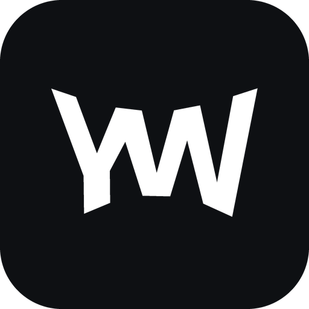

<p align="center">
  
</p>

<h1 align="center">YW Studio</h1>

<p align="center"><strong>A free, open-source DAW in the FL Studio workflow — made for <a href="https://yolo.su">yolo.su</a> and the #YW collective.</strong><br>
Patterns, Channel rack, Piano roll, Playlist and Mixer. Opens FL Studio projects (.flp) and loads your VST2, VST3 and CLAP plugins.</p>

<p align="center">
  <a href="https://yolo.su"><strong>yolo.su</strong></a> ·
  <a href="https://github.com/convicted3/yw-studio/actions/workflows/build-windows.yml"><strong>Download (latest build)</strong></a> ·
  <a href="#building">Build from source</a>
</p>

## What is YW Studio?

YW Studio is a lightweight digital audio workstation for Windows 10/11 (macOS and Linux later). It follows the FL Studio
way of working — the Channel rack and step sequencer, the Piano roll, the Playlist with patterns and audio clips and the
Mixer with ten effect slots per insert — in YW's own look.

- **Your projects:** opens `.flp` (FL Studio), `.als`, `.flm` and `.dawproject`; saves its own projects and exports `.flp`.
- **Your plugins:** VST2, VST3 and CLAP instruments and effects, each in its own process so a crashing plugin never takes
  the program down; 32-bit plugins through a bridge.
- **Low latency:** ASIO, WASAPI (shared, low-latency and exclusive) and the built-in **YW ASIO** driver.
- **Built-in instruments and effects:** synths, sampler, drum machine, EQ, compressor, limiter, reverb, delay and more.
- **YW plugins:** the built-in effects also as CLAP / VST3 plugins for other hosts.

## Download

Windows builds come from GitHub Actions: open the latest successful run of
[Build Windows](https://github.com/convicted3/yw-studio/actions/workflows/build-windows.yml) and download the
**YW-Studio-windows** artifact (a portable zip and an installer). Unzip and run `YW Studio.exe`.

## Building

The Windows build is a cross compile from Linux with Zig and JUCE 8.0.4:

```bash
ZIG=/path/to/zig JUCE_DIR=/path/to/JUCE-8.0.4 OUT=build-win JOBS=2 ./scripts/build-windows-zig.sh
```

On Linux and macOS: `cmake -S . -B build -G Ninja -DCMAKE_BUILD_TYPE=Release && cmake --build build`.

## Credits

Based on LYNX SHARE by Ka1-S, AGPL-3.0.

Every open-source component and its licence is listed in [THIRD_PARTY.md](THIRD_PARTY.md). FL Studio is a trademark of
Image-Line; YW Studio is not affiliated with Image-Line.

## License

YW Studio is free software under the [GNU Affero General Public License v3.0](LICENSE). The complete source code is in
this repository.
